<!-- Theme: Studio Blue. Animated scenes live in /assets (scene-pair, walk-strip, scene-footer, status-pulse, divider). -->

  <picture>
    <source media="(prefers-color-scheme: dark)" srcset="https://capsule-render.vercel.app/api?type=waving&color=0:1A1B27,100:24283B&height=200&section=header&text=Ijaz%20Fouzer&fontSize=56&fontColor=70A5FD&animation=fadeIn&fontAlignY=36&desc=Make%20it%20work.%20Make%20it%20feel%20right.&descSize=18&descAlignY=58">
    
  </picture>

  <picture>
    <source media="(prefers-color-scheme: dark)" srcset="https://readme-typing-svg.demolab.com/?font=Fira+Code&size=20&duration=2200&pause=1800&color=70A5FD&center=true&vCenter=true&repeat=true&width=720&height=48&lines=Turning+busy+operations+into+calm+software;Web+%2B+mobile+%C2%B7+product+direction;Got+an+idea%3F+Let%27s+talk.">
    
  </picture>

   

  
  

    

  <a href="#selected-work">Work</a> ·
  <a href="#github-activity">Activity</a> ·
  <a href="#start-a-conversation">Contact</a> ·
  <a href="https://github.com/IjaasMohamed?tab=repositories">Repositories</a>

 

<b>Most software fails in the gap between how a business runs and how the tool expects it to. I work in that gap.</b>

<table>
  <tr>
    <td width="33%" valign="top"><b>Direction</b> What to build, and why.</td>
    <td width="33%" valign="top"><b>Workflow</b> Software shaped around real work.</td>
    <td width="33%" valign="top"><b>Delivery</b> From build to acceptance.</td>
  </tr>
</table>

## Selected work

<table>
  <tr>
    <td width="50%" valign="top">
      <b>FOUXER Gaming Zone Manager</b> 
      Billing, café sales, stock, and daily closing in one workspace for gaming lounges.
        
      
        
      

        
Role, highlights, stack

         
        <b>Role:</b> product direction, workflow design, and development oversight across the web portal and Windows cashier. 
        <b>Highlights:</b> session pricing, café checkout, stock tracking, role-based access, financial reports, offline cashier. 
        <b>Stack:</b> Next.js, React, TypeScript, Tailwind CSS, PostgreSQL, Drizzle ORM, Better Auth.
      

      Private repository. <a href="https://linkedin.com/in/ijaas-f-948804112">Ask for a walkthrough →</a>
    </td>
    <td width="50%" valign="top">
      <b>FOUXER Madrasa Management System (DQLI)</b> 
      Student records, attendance, Quran progress, and fees for madrasa staff across branches.
        
      
        
      

        
Role, highlights, stack

         
        <b>Role:</b> product direction, staff workflow design, and development coordination through acceptance review. 
        <b>Highlights:</b> registration, branch permissions, attendance, recitation tracking, fee receipts, private documents. 
        <b>Stack:</b> React, TypeScript, Vite, Tailwind CSS, Supabase Auth, PostgreSQL.
      

      Private repository. <a href="https://linkedin.com/in/ijaas-f-948804112">Ask for a walkthrough →</a>
    </td>
  </tr>
</table>

    

  <a href="https://github.com/IjaasMohamed">
    <picture>
      <source media="(prefers-color-scheme: dark)" srcset="https://github-readme-activity-graph.ashutosh-dwivedi0710.workers.dev/graph?username=IjaasMohamed&bg_color=1A1B27&color=A9B1D6&title_color=70A5FD&line=70A5FD&point=70A5FD&area=true&area_color=70A5FD&hide_border=true&height=250">
      
    </picture>
  </a>

Languages, streaks, and milestones

 

  <picture>
    <source media="(prefers-color-scheme: dark)" srcset="https://github-stats-extended.vercel.app/api/top-langs/?username=IjaasMohamed&layout=compact&langs_count=6&hide_border=true&bg_color=1A1B27&title_color=70A5FD&text_color=A9B1D6">
    
  </picture>

    

  <picture>
    <source media="(prefers-color-scheme: dark)" srcset="https://streak-stats.demolab.com/?user=IjaasMohamed&hide_border=true&background=1A1B27&ring=70A5FD&fire=70A5FD&currStreakLabel=70A5FD&sideLabels=70A5FD&currStreakNum=A9B1D6&sideNums=A9B1D6&dates=A9B1D6&stroke=A9B1D6">
    
  </picture>

    

  <picture>
    <source media="(prefers-color-scheme: dark)" srcset="https://github-trophies.devomb.com/?username=IjaasMohamed&theme=tokyonight&column=3&row=1&title=Commits,Repositories,PullRequest&no-bg=true&no-frame=true">
    
  </picture>

Cards are snapshots of activity, not a full picture of my work.

  <picture>
    <source media="(prefers-color-scheme: dark)" srcset="https://raw.githubusercontent.com/IjaasMohamed/IjaasMohamed/output/github-snake-dark.svg?v=1">
    
  </picture>

## Start a conversation

  <picture>
    <source media="(prefers-color-scheme: dark)" srcset="https://readme-typing-svg.demolab.com/?font=Fira+Code&size=22&duration=2400&pause=2500&color=70A5FD&center=true&vCenter=true&repeat=true&width=720&height=52&lines=Have+an+idea%3F;Tell+me+what+you%27re+building.;Let%27s+make+it+feel+right.">
    
  </picture>

   

  
  
  <!-- OPTIONAL email button: replace you@example.com, then remove the comment markers
  
  -->

    

  Two lines is enough to start.

    

  <a href="https://stackoverflow.com/users/20230821">Stack Overflow</a> ·
  <a href="https://reddit.com/user/IjaasFouzer">Reddit</a> ·
  <a href="https://buymeacoffee.com/undyin0J">Buy me a coffee</a>

 

